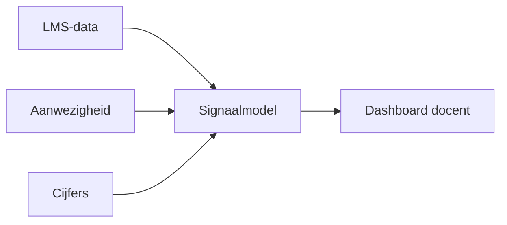

<!-- Slide: Titelslide -->

  <h1 style="font-size: 3.2rem; line-height: 1.15; margin-bottom: 0.6rem; color: var(--np-ink);">Leeranalytics in het onderwijs</h1>
  

    Van studeergedrag naar concrete inzichten voor docent en student
  

  

    <strong>CEDA</strong> &middot; Centre of Educational Data Analytics
  

  
Npuls &middot; 2026

<!--
Testdeck voor de clidev skill na herinstallatie: oefent alle achtergronden (Slide1-17),
kleurencombinaties en componentklassen uit ter verificatie.
-->

<!-- Slide: Agenda -->
---

  
Wat gaan we bespreken

  <h1 style="font-size: 2.2rem !important; margin-bottom: 1.4rem;">Programma</h1>
  

    

      1
      
<strong>Waarom leeranalytics</strong> Context en cijfers

    

    

      2
      
<strong>Hoe pakken we het aan</strong> Aanpak en proces

    

    

      3
      
<strong>Wat betekent dit voor jou</strong> Rollen en vervolgstappen

    

    

      4
      
<strong>Vragen</strong> Ruimte voor discussie

    

  

<!-- Slide: Hoofdstuk 1 - Waarom leeranalytics -->
---

  

    
Deel 1

    <h1 style="color: var(--np-ink); font-size: 3rem;">Waarom leeranalytics</h1>
  

<!-- Slide: Wat is leeranalytics? -->
---

# Wat is leeranalytics?

Data inzetten om het leerproces te begrijpen en te verbeteren.

  <ul style="font-size: 0.92rem; line-height: 1.7;">
    <li>Studeergedrag in beeld brengen</li>
    <li>Vroeg signaleren wie dreigt uit te vallen</li>
    <li>Docenten ondersteunen met concrete inzichten</li>
    <li>Beleid baseren op bewijs, niet op aannames</li>
  </ul>

  

    <h3>Kernpunt</h3>
    

      Leeranalytics is geen doel op zich, maar een hulpmiddel voor betere begeleiding.
    

  

<!-- Slide: Leeranalytics in cijfers -->
---

# Leeranalytics in cijfers

Enkele kengetallen uit lopende CEDA-projecten.

  

    
73%

    
van de instellingen gebruikt al vorm van studievoortgangsdata

  

  

    
4x

    
sneller signaleren van studievertraging

  

  

    
12

    
deelnemende instellingen in de pilot

  

<!-- Slide: Kans en risico -->
---

  

    <h1 style="color: #FFFFFF !important; font-size: 1.9rem;">Kans en risico</h1>
    
Twee kanten van dezelfde data.

  

  

    

      <h3>Kans</h3>
      
Eerder ingrijpen, gerichter begeleiden, minder uitval.

    

    

      <h3>Risico</h3>
      
Verkeerde interpretatie zonder zorgvuldig privacybeleid.

    

  

<!-- Slide: Van data naar inzicht -->
---

# Van data naar inzicht

  <ul style="font-size: 0.95rem; line-height: 1.8;">
    <li>Ruwe logdata uit de leeromgeving</li>
    <li>Bewerkt tot herkenbare patronen</li>
    <li>Vertaald naar een dashboard voor de docent</li>
  </ul>

  

<!-- Slide: Hoofdstuk 2 - Hoe pakken we het aan -->
---

  

    
Deel 2

    <h1 style="color: #FFFFFF !important; font-size: 3rem;">Hoe pakken we het aan</h1>
    
Van pilot naar structurele aanpak

  

<!-- Slide: Ons stappenplan -->
---

<!-- De oranje golf beslaat de volle hoogte van de linkerkolom (0-38% breed);
     titel staat daarom boven de kaarten in de rechterkolom, niet ernaast,
     om overlap met de decoratie te voorkomen. -->

  

  

    

      
Aanpak

      <h1 style="font-size: 1.7rem; margin-bottom: 0.1rem;">Ons stappenplan</h1>
      
Vier stappen van idee naar dashboard.

    

    

      1
      <strong style="margin-left: 0.6rem;">Verkennen</strong>
      
Welke vraag speelt er bij de docent?

    

    

      2
      <strong style="margin-left: 0.6rem;">Data verzamelen</strong>
      
Bronnen koppelen, kwaliteit checken.

    

    

      3
      <strong style="margin-left: 0.6rem;">Analyseren</strong>
      
Patronen zoeken, model valideren.

    

    

      4
      <strong style="margin-left: 0.6rem;">Opleveren</strong>
      
Dashboard live bij de docent.

    

  

<!-- Slide: Wat het oplevert -->
---

# Wat het oplevert

Drie directe voordelen voor de onderwijsorganisatie.

  

    Vroegsignalering
    <h3 style="margin-top: 0.5rem;">Eerder ingrijpen</h3>
    
Studenten met risico op uitval worden weken eerder zichtbaar.

  

  

    Overzicht
    <h3 style="margin-top: 0.5rem;">Eén dashboard</h3>
    
Alle voortgangsdata bij elkaar, geen losse spreadsheets meer.

  

  

    Onderbouwing
    <h3 style="margin-top: 0.5rem;">Beter beleid</h3>
    
Keuzes baseren op patronen in plaats van losse signalen.

  

  De <strong>kernboodschap</strong>: eerder zien is eerder kunnen helpen.

<!-- Slide: Zo ziet het dashboard eruit -->
---

<!-- De roze rechthoek loopt door tot ~48% breedte; tekstkolom begint daarom
     bij 50% (niet 42%), anders overlapt de gecenterde screenshot-kaart de tekst. -->

  

  

    
Voorbeeld

    <h1 style="font-size: 1.8rem;">Zo ziet het dashboard eruit</h1>
    <ul style="font-size: 0.9rem; line-height: 1.7; margin-top: 0.5rem;">
      <li>Overzicht per student en per groep</li>
      <li>Signalen op basis van meerdere databronnen</li>
      <li>Direct filterbaar voor de docent</li>
    </ul>
  

<!-- Roze rechthoek in Slide7.PNG gemeten op exacte pixelgrenzen (7%-48% breed,
     10%-90% hoog); frame wordt daarbinnen gecenterd i.p.v. los geschat. -->

  

    
  

<!--
Testafbeelding uit public/shots/ ter verificatie van de np-frame layout,
geen definitieve productscreenshot.
-->

<!-- Slide: Rollen rond het dashboard -->
---

  

    
Gebruik

    <h1 style="font-size: 1.8rem;">Rollen rond het dashboard</h1>
    <ul style="font-size: 0.9rem; line-height: 1.7; margin-top: 0.5rem;">
      <li>Docent: dagelijkse signalen per groep</li>
      <li>Studieloopbaanbegeleider: individuele trajecten</li>
      <li>Management: trends op instellingsniveau</li>
    </ul>
  

  

<!-- Roze rechthoek in Slide8.PNG gemeten op exacte pixelgrenzen (54%-95% breed,
     10%-90% hoog); frame wordt daarbinnen gecenterd i.p.v. los geschat. -->

  

    
  

<!-- Slide: Citaat uit de pilot -->
---

<!-- Slide6.PNG heeft een lichtgrijze driehoek links (~0-28%); tekst blijft
     daarom rechts van 32% in plaats van volledig gecentreerd, anders valt
     de witte tekst weg tegen het lichte vlak. -->

  

    "Voor het eerst zie ik als docent wie er dreigt af te haken, voordat het te laat is."
  

  
&mdash; Docent, pilotinstelling

<!-- Slide: Hoofdstuk 3 - Wat betekent dit voor jou -->
---

  

    
Deel 3

    <h1 style="color: #FFFFFF !important; font-size: 3rem;">Wat betekent dit voor jou</h1>
    
Rollen, randvoorwaarden en vervolgstappen

  

<!-- Slide: Van pilot naar praktijk -->
---

# Van pilot naar praktijk

Vier stappen om een pilot te laten landen in de organisatie.

  

    <strong style="font-size: 0.95rem;">Pilot</strong>
    <small>Klein starten, snel leren</small>
  

  
&#8594;

  

    <strong style="font-size: 0.95rem;">Evalueren</strong>
    <small>Werkt het echt beter</small>
  

  
&#8594;

  

    <strong style="font-size: 0.95rem;">Opschalen</strong>
    <small>Naar meer opleidingen</small>
  

  
&#10003;Gedragen door docenten

  

  
&#10003;Privacy geborgd

  

  
&#10003;Techniek stabiel

<!-- Slide: Welke databronnen gebruiken we -->
---

# Welke databronnen gebruiken we

| Bron | Update-frequentie | Eigenaar |
|------|-------------------|----------|
| Leeromgeving (LMS) | Dagelijks | ICT-afdeling |
| Studentinformatiesysteem | Wekelijks | Onderwijsbureau |
| Aanwezigheidsregistratie | Dagelijks | Roostering |
| Studievoortgangsgesprekken | Per kwartaal | Studieloopbaanbegeleider |

<!-- Slide: Hoe de signalen samenkomen -->
---

# Hoe de signalen samenkomen

<!-- Mermaid-blok rendert standaard linksuitgelijnd; wrap in een flex-container
     om het diagram te centreren binnen de slide. -->

<!-- Slide: Visueel intermezzo -->
---

<!-- Slide: Contact -->
---

  

    
Meer weten

    <h1 style="font-size: 2rem;">Over ons</h1>
    
CEDA ondersteunt onderwijsinstellingen bij het datagedreven werken.

    <ul style="font-size: 0.9rem; line-height: 1.7;">
      <li>Advies en implementatie leeranalytics</li>
      <li>Gedeelde infrastructuur voor mbo, hbo en wo</li>
      <li>Privacy en ethiek als vast onderdeel</li>
    </ul>
  

  

<!-- Slide: Afsluitslide -->
---

