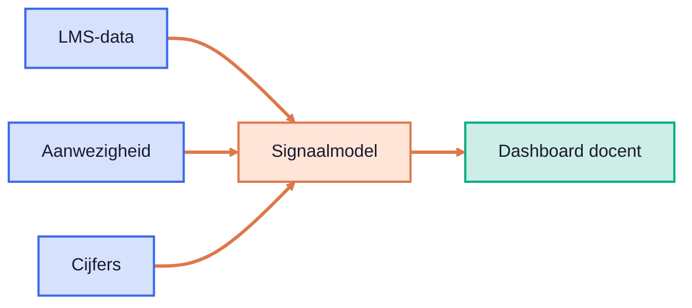

<!-- Slide: Titelslide -->

  <h1 style="font-size: 3.2rem; line-height: 1.15; margin-bottom: 0.6rem; color: var(--np-ink);">Van data naar studiesucces</h1>
  

    Hoe ruwe onderwijsdata vroege signalen en concrete actie wordt
  

  

    <strong>CEDA</strong> &middot; Centre of Educational Data Analytics
  

  
Npuls &middot; 2026

<!--
Tweede, langere testpresentatie voor de clidev skill. Hergebruikt alle recent
gefixte patronen (Slide6/Slide11-layout, screenshot- en mermaid-centrering,
expliciete ul/li) in geheel nieuwe content, en sluit af met de vaste
CEDA-slide uit _template.md.
-->

<!-- Slide: Agenda -->
---

  
Wat gaan we bespreken

  <h1 style="font-size: 2.2rem !important; margin-bottom: 1.4rem;">Programma</h1>
  

    

      1
      
<strong>Het probleem</strong> Waarom losse oplossingen niet werken

    

    

      2
      
<strong>De aanpak</strong> Werkwijze en wat je krijgt

    

    

      3
      
<strong>In de praktijk</strong> Dashboard, databronnen en signalen

    

    

      4
      
<strong>Wat betekent dit voor jou</strong> Rollen en vervolgstappen

    

  

<!-- VASTE CEDA-SLIDE (Slide16.PNG) — woordelijk overnemen, niet aanpassen
     of weglaten. Staat vroeg in het deck (direct na de agenda, vóór de
     eerste hoofdstukdivider). Zie SKILL.md, sectie "Vaste CEDA-slide". -->
---

<!-- De roze rechthoek in Slide16.PNG begint exact bij 50% breedte (niet 60%);
     content-kolom eindigt daarom ruim vóór 50%. -->

  

    
Wie is CEDA

    <h1 style="font-size: 1.7rem;">Centre of Educational Data Analytics</h1>
    
Eén team binnen Npuls. Van ruwe data tot AI-toepassing, open source.

    <ul style="font-size: 0.88rem; line-height: 1.7;">
      <li>Data, analytics en generatieve AI in één keten</li>
      <li>Altijd in co-creatie met mbo, hbo en wo</li>
      <li>Open source, voor elke instelling</li>
    </ul>
  

  

<!-- Slide: Hoofdstuk 1 - Het probleem -->
---

  

    
Deel 1

    <h1 style="color: var(--np-ink); font-size: 3rem;">Het probleem</h1>
  

<!-- Slide: Elke instelling worstelt met dezelfde data -->
---

# Elke instelling worstelt met dezelfde data

Studievoortgang, aanwezigheid en cijfers zitten overal, maar zelden bij elkaar.

  <ul style="font-size: 0.92rem; line-height: 1.7;">
    <li>Data zit verspreid over LMS, SIS en Excel-bestanden</li>
    <li>Elke instelling bouwt er eigen scripts omheen</li>
    <li>Signalen komen vaak pas als het al te laat is</li>
    <li>Hetzelfde werk, telkens opnieuw, achter gesloten deuren</li>
  </ul>

  

    <h3>Ons antwoord</h3>
    

      Bouw het één keer goed, deel het, onderhoud het samen — in plaats van dat elke instelling apart investeert.
    

  

<!-- Slide: Studiesucces in cijfers -->
---

# Studiesucces in cijfers

Kengetallen uit lopende CEDA-projecten rond vroegsignalering.

  

    
68%

    
van de instellingen mist een centraal overzicht van voortgangsdata

  

  

    
6-8

    
weken eerder een risicostudent in beeld met een gedeeld signaalmodel

  

  

    
9

    
instellingen die meebouwen aan de gedeelde voorziening

  

<!-- Slide: Los of samen -->
---

  

    <h1 style="color: #FFFFFF !important; font-size: 1.9rem;">Los of samen</h1>
    
De keuze is niet óf we data gebruiken, maar hoe.

  

  

    

      <h3>Los</h3>
      
Elke instelling bouwt apart, of leunt op een commerciële partij die de voorwaarden bepaalt.

    

    

      <h3>Samen</h3>
      
Data, modellen en keuzes blijven van de instellingen zelf. Open source, gedeeld onderhoud.

    

  

<!-- Slide: Van ruwe data naar een dashboard -->
---

# Van ruwe data naar een dashboard

  <ul style="font-size: 0.95rem; line-height: 1.8;">
    <li>Ruwe bestanden uit LMS, SIS en aanwezigheidsregistratie</li>
    <li>Gevalideerd en gekoppeld via een uniek studentnummer</li>
    <li>Vertaald naar signalen die een docent direct snapt</li>
  </ul>

  

<!-- Slide: Hoofdstuk 2 - De aanpak -->
---

  

    
Deel 2

    <h1 style="color: #FFFFFF !important; font-size: 3rem;">De aanpak</h1>
    
Werkwijze en wat je ervoor terugkrijgt

  

<!-- Slide: Onze werkwijze -->
---

<!-- De oranje golf beslaat de volle hoogte van de linkerkolom (0-38% breed);
     titel staat daarom boven de kaarten in de rechterkolom, niet ernaast. -->

  

  

    

      
Werkwijze

      <h1 style="font-size: 1.7rem; margin-bottom: 0.1rem;">Onze werkwijze</h1>
      
Vier stappen, altijd samen met een instelling.

    

    

      1
      <strong style="margin-left: 0.6rem;">Verkennen</strong>
      
Welke vraag speelt er bij de instelling?

    

    

      2
      <strong style="margin-left: 0.6rem;">Data koppelen</strong>
      
Bronnen valideren en aan elkaar koppelen.

    

    

      3
      <strong style="margin-left: 0.6rem;">Signalen bouwen</strong>
      
Patronen zoeken, model valideren met de instelling.

    

    

      4
      <strong style="margin-left: 0.6rem;">Opleveren</strong>
      
Dashboard live, open source, direct bruikbaar.

    

  

<!-- Slide: Wat je krijgt -->
---

# Wat je krijgt

Drie directe voordelen voor de onderwijsorganisatie.

  

    Vroegsignalering
    <h3 style="margin-top: 0.5rem;">Eerder ingrijpen</h3>
    
Risicostudenten weken eerder in beeld, met tijd om echt te helpen.

  

  

    Overzicht
    <h3 style="margin-top: 0.5rem;">Eén dashboard</h3>
    
Alle voortgangsdata bij elkaar, geen losse spreadsheets meer.

  

  

    Eigenaarschap
    <h3 style="margin-top: 0.5rem;">Open source</h3>
    
Data, model en keuzes blijven van de instelling zelf.

  

  De <strong>kernboodschap</strong>: eerder zien is eerder kunnen helpen.

<!-- Slide: Zo ziet het dashboard eruit -->
---

<!-- De roze rechthoek loopt door tot ~48% breedte; tekstkolom begint daarom
     bij 50% (niet 40-42%), anders overlapt de gecenterde screenshot-kaart de tekst. -->

  

  

    
Voorbeeld

    <h1 style="font-size: 1.8rem;">Zo ziet het dashboard eruit</h1>
    <ul style="font-size: 0.9rem; line-height: 1.7; margin-top: 0.5rem;">
      <li>Overzicht per student en per groep</li>
      <li>Signalen op basis van meerdere databronnen</li>
      <li>Direct filterbaar voor de docent</li>
    </ul>
  

<!-- Roze rechthoek in Slide7.PNG gemeten op exacte pixelgrenzen (7%-48% breed,
     10%-90% hoog); frame wordt daarbinnen gecenterd i.p.v. los geschat. -->

  

    
  

<!--
Testafbeelding uit public/shots/ ter verificatie van de np-frame layout,
geen definitieve productscreenshot.
-->

<!-- Slide: Rollen rond het dashboard -->
---

  

    
Gebruik

    <h1 style="font-size: 1.8rem;">Rollen rond het dashboard</h1>
    <ul style="font-size: 0.9rem; line-height: 1.7; margin-top: 0.5rem;">
      <li>Docent: dagelijkse signalen per groep</li>
      <li>Studieloopbaanbegeleider: individuele trajecten</li>
      <li>Management: trends op instellingsniveau</li>
    </ul>
  

  

<!-- Roze rechthoek in Slide8.PNG gemeten op exacte pixelgrenzen (54%-95% breed,
     10%-90% hoog); frame wordt daarbinnen gecenterd i.p.v. los geschat. -->

  

    
  

<!-- Slide: Citaat uit de praktijk -->
---

<!-- Slide6.PNG heeft een lichtgrijze driehoek links (~0-28%); tekst blijft
     daarom rechts van 32% in plaats van volledig gecentreerd. -->

  

    "We zagen risicostudenten voorheen pas bij het studievoortgangsgesprek. Nu weken eerder."
  

  
&mdash; Studieloopbaanbegeleider, pilotinstelling

<!-- Slide: Hoofdstuk 3 - In de praktijk -->
---

  

    
Deel 3

    <h1 style="color: #FFFFFF !important; font-size: 3rem;">In de praktijk</h1>
    
Dashboard, databronnen en signalen

  

<!-- Slide: Van pilot naar praktijk -->
---

# Van pilot naar praktijk

Vier stappen om een pilot te laten landen in de organisatie.

  

    <strong style="font-size: 0.95rem;">Pilot</strong>
    <small>Klein starten, snel leren</small>
  

  
&#8594;

  

    <strong style="font-size: 0.95rem;">Evalueren</strong>
    <small>Werkt het echt beter</small>
  

  
&#8594;

  

    <strong style="font-size: 0.95rem;">Opschalen</strong>
    <small>Naar meer opleidingen</small>
  

  
&#10003;Gedragen door docenten

  

  
&#10003;Privacy geborgd

  

  
&#10003;Techniek stabiel

<!-- Slide: Welke databronnen gebruiken we -->
---

# Welke databronnen gebruiken we

| Bron | Update-frequentie | Eigenaar |
|------|-------------------|----------|
| Leeromgeving (LMS) | Dagelijks | ICT-afdeling |
| Studentinformatiesysteem | Wekelijks | Onderwijsbureau |
| Aanwezigheidsregistratie | Dagelijks | Roostering |
| Studievoortgangsgesprekken | Per kwartaal | Studieloopbaanbegeleider |

<!-- Slide: Hoe de signalen samenkomen -->
---

# Hoe de signalen samenkomen

<!-- Mermaid-blok rendert standaard linksuitgelijnd én met dunne, nauwelijks
     zichtbare lijnen; wrap in een flex-container om te centreren, en gebruik
     classDef + linkStyle voor kleur en dikte (zie SKILL.md, sectie Mermaid). -->

<!-- Slide: Visueel intermezzo -->
---

<!-- Slide: Hoofdstuk 4 - Wat betekent dit voor jou -->
---

  

    
Deel 4

    <h1 style="color: var(--np-ink); font-size: 3rem;">Wat betekent dit voor jou</h1>
  

<!-- Slide: Rollen en vervolgstappen -->
---

# Rollen en vervolgstappen

Wat dit betekent, afhankelijk van jouw rol.

  

    Docent
    <h3 style="margin-top: 0.5rem;">Dagelijkse signalen</h3>
    
Zie per groep wie extra aandacht nodig heeft, zonder zelf data te verzamelen.

  

  

    SLB'er
    <h3 style="margin-top: 0.5rem;">Onderbouwde gesprekken</h3>
    
Ga het gesprek aan met concrete signalen in plaats van een onderbuikgevoel.

  

  

    Management
    <h3 style="margin-top: 0.5rem;">Trends op instellingsniveau</h3>
    
Volg uitval en studiesucces op groepen, opleidingen en cohorten.

  

  Wil je meedoen? We starten graag een <strong>pilot bij jouw instelling</strong>.

<!-- VASTE AFSLUITSLIDE (Slide1.PNG) — woordelijk overnemen, niet aanpassen
     of weglaten. Altijd de laatste slide van het deck: bevat de vaste
     CEDA-links. Zie SKILL.md, sectie "Vaste CEDA-slide (intro) en vaste
     afsluitslide (links)". -->
---

  
Tot slot

  <h1 style="font-size: 2.6rem; line-height: 1.15; margin-bottom: 0.6rem; color: var(--np-ink);">Blijf in contact</h1>
  
Vragen, feedback of zin om mee te bouwen? We horen graag van je.

  

    

      GitHub
      
github.com/cedanl

    

    

      Community
      
community.npuls.nl/groups/data-ai

    

    

      Email
      
ceda@surf.nl

    

  

